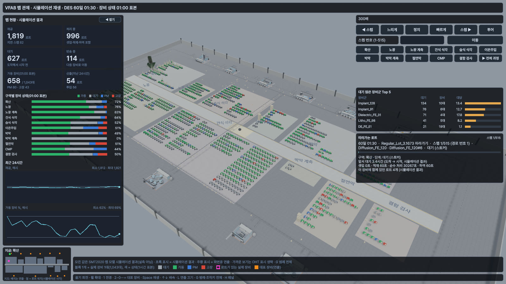
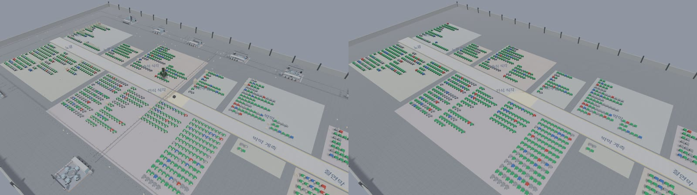
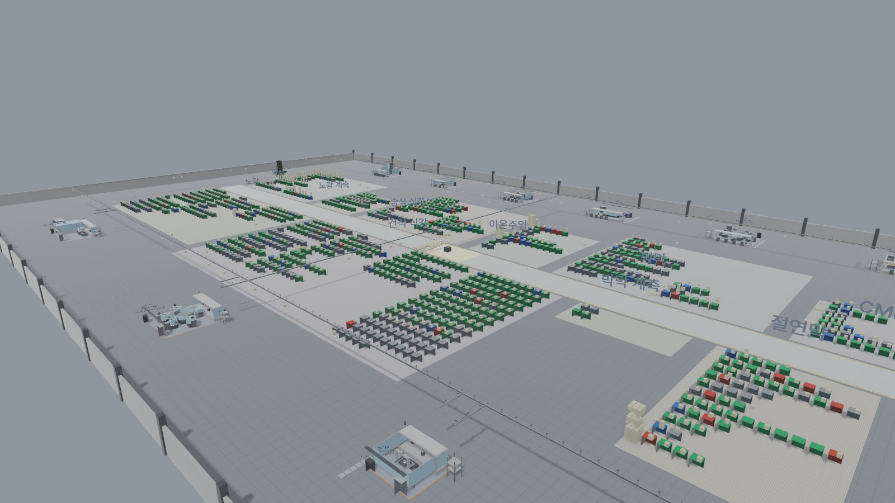
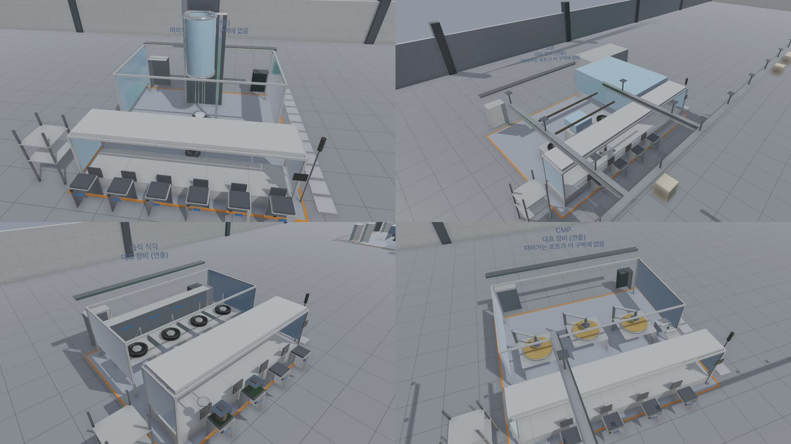
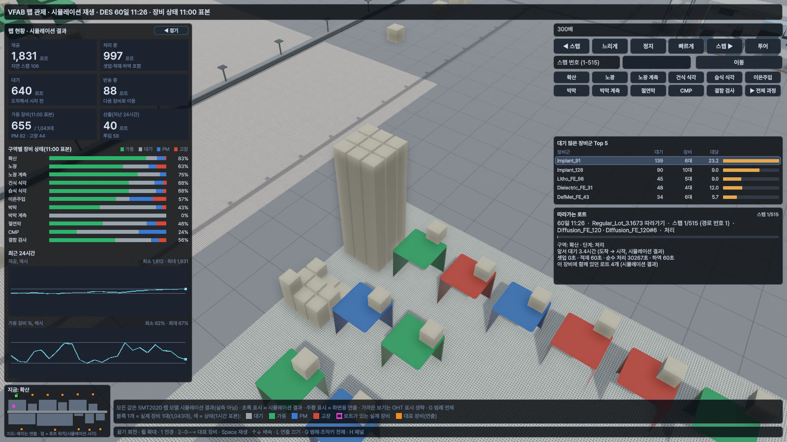
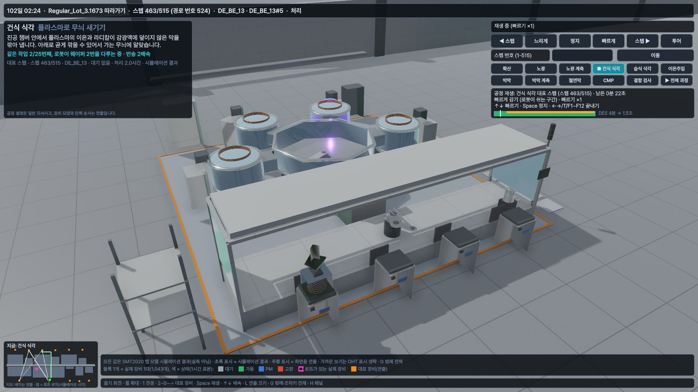
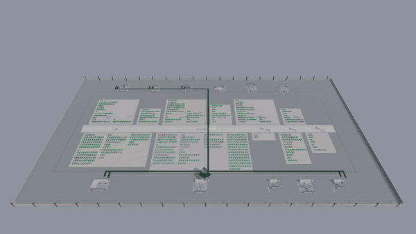
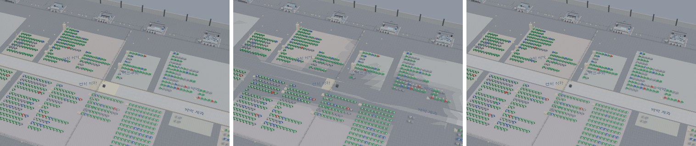
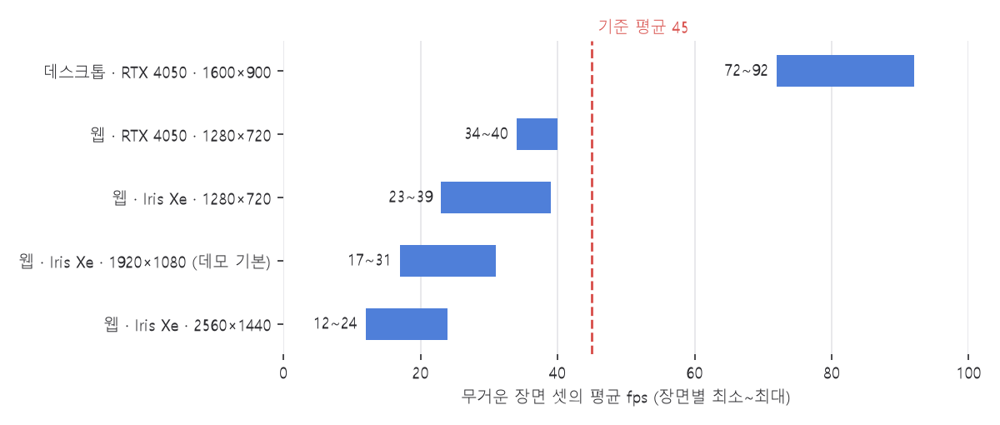
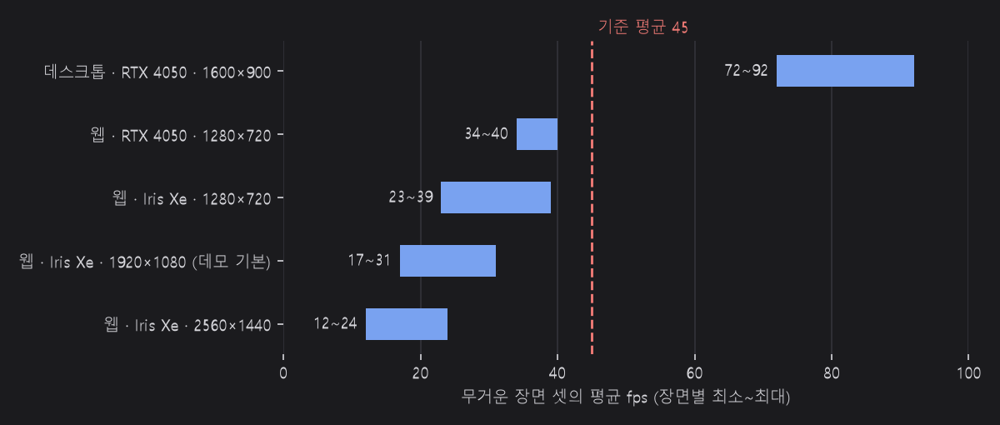

[이전 글](/posts/vfab-fab-simulation/)에서 만든 SMT2020 시뮬레이터의 실행 결과를 Unity로 3D 팹에 재생했고, 이번에 WebGL로 빌드해 브라우저에서 바로 돌려 볼 수 있게 했다. 표와 그래프만으로는 로트 하나가 515스텝을 어떻게 지나가는지, 병목 앞에 로트가 얼마나 쌓이는지가 잘 읽히지 않았다. 그래서 같은 실행 결과를 장비 1,043대가 있는 팹 위에서 시간 순서대로 다시 돌렸다.

| 항목 | 값 |
|---|---|
| 재생하는 것 | SMT2020 HVLM 시뮬레이션 한 번(시드 1, 130일)의 결과. 로트 하나(`Regular_Lot_3.1673`)의 515스텝 46일과, 같은 시각 팹의 다른 로트 4,463개 |
| 팹 | 장비 1,043대를 블록 하나씩, 11구역마다 대표 장비 1대를 절차적 모델로 |
| 엔진 | Unity 6000.3, 내장 렌더 파이프라인, Post Processing v2, IMGUI |
| 웹 빌드 | WebGL 2, 내려받기 약 28MB(gzip). 로컬 서버에서 첫 화면까지 처음 9~12초, 다시 열 때 5~7초(내려받는 시간 제외) |
| 검증 | 화면 검사 14,844개 실패 0, 규칙을 하나씩 깨는 음성 시험 37종 모두 잡힘, 데스크톱과 웹의 같은 장면 픽셀 비교 |
| 성능 | 기준(평균 45fps, 느린 1% 30fps) 미달. 노트북 내장 GPU에서 무거운 장면 17~39fps |

[](/demos/vfab-fab-tour/){:target="_blank"}
_처음 뜨는 관제 화면. 300배속으로 돌리는 중이고, 크림색 작은 상자 하나가 로트 하나다_

**[브라우저에서 실행 (새 탭, 약 28MB, PC용)](/demos/vfab-fab-tour/){:target="_blank"}**

## 1. 무엇이 시뮬레이션이고 무엇이 연출인가

화면에는 시뮬레이션이 낸 값과 화면을 위해 지어낸 것이 섞여 있다. 둘이 구분되지 않으면 그림이 아무리 그럴듯해도 쓸모가 없어서, 처음부터 색으로 나눴다.

| 구분 | 무엇 | 표시 |
|---|---|---|
| 시뮬레이션 결과 | 로트가 어느 장비에서 언제 대기·처리·반송됐는지, 셋업·적재·처리·수리·하역 길이, 장비 상태(1시간 표본), 팹 전체 로트가 어느 장비에 있는지 | 초록 |
| 연출 | 웨이퍼 한 장 단위 순서, 로봇과 OHT 경로, 플라스마 같은 공정 효과, 대표 장비가 실제 장비를 대신 보이는 것, 로트 상자가 놓이는 자리 | 주황 |

L 키를 누르면 연출이 모두 숨는다. 대표 장비, 로봇, 레일과 OHT가 사라지고, 로트 상자도 함께 숨는다. 상자가 어느 장비에 몇 개 있는지는 시뮬레이션 값이지만, 더미로 쌓이는 자리와 레일 위의 경로는 지어낸 것이라서다. 남는 건 장비 1,043대의 상태색뿐이다.


_왼쪽은 연출을 켠 화면, 오른쪽은 L을 눌러 끈 화면. 블록 색(초록 가동, 회색 대기, 파랑 PM, 빨강 고장)은 그대로 남는다_

SMT2020은 실측 로그가 아니라 업계 표준 팹 모델이다. 여기 나오는 숫자도 그 모델 안의 이야기다.

## 2. 팹: 블록 1,043개와 대표 장비 11대


_팹 전경. 바닥의 구역 판마다 같은 공정 장비가 모여 있고, 위아래 가장자리를 따라 대표 장비 11대가 서 있다_

SMT2020에는 툴그룹별 장비 대수만 있고 평면도는 없다. 그래서 장비 1,043대를 블록 하나씩으로 그리고, 확산·노광·식각 같은 11구역으로 묶어 바닥에 배치했다. 블록 하나가 실제 장비 한 대이고, 색은 그 장비의 1시간 표본 상태다. 배치는 연출이다.

블록만으로는 장비 안에서 무슨 일이 일어나는지 보이지 않는다. 그래서 구역마다 대표 장비 한 대를 절차적 모델로 만들었다. 메시는 외부 에셋 없이 코드로 짰고, 로봇 팔은 IK로 웨이퍼를 집는다.


_왼쪽 위부터 확산로(세로 튜브와 보트), 노광 트랙, 습식 식각 배스, CMP(노란 패드 셋). 앞쪽에 줄지어 있는 건 FOUP를 올리는 로드 포트다_

## 3. 화면 세 가지

### 관제 화면

처음 화면이다. 가운데에서 팹 전체가 돈다. 다른 로트는 크림색 상자로 보이고, 처리 중이면 장비 블록 위에, 대기 중이면 장비군 앞에 3×3 더미로, 반송 중이면 레일 높이로 움직인다. 병목은 더미 높이로 보인다.

왼쪽 판에는 재공, 처리 중, 대기, 반송 중, 가동 장비, 지난 24시간 산출과 구역별 장비 상태, 최근 24시간 추이를 둔다. 오른쪽의 "대기 많은 장비군 Top 5"에서 행을 누르면 카메라가 그 장비군의 대기 더미로 날아간다.


_Top 5 첫 줄 `Implant_91`(대기 139로트, 장비 6대)을 누른 화면. 기둥 하나가 대기 로트 더미이고, 옆의 색 블록이 그 장비군이다_

### 공정 버튼

11구역 버튼을 누르면 그 구역의 대표 스텝을 장비 안까지 재생한다. 로봇이 FOUP에서 웨이퍼를 꺼내 공정 자리에 놓고, 처리가 끝나면 다시 가져간다. 웨이퍼마다 같은 작업이 되풀이되는 구간은 세 번만 보여 주고(웨이퍼 1번은 1배속, 2번째는 2배속, 3번째는 3배속) 나머지는 건너뛴다. 로봇이 쉬는 구간은 빨리 감는다.


_건식 식각 버튼(스텝 463/515, `DE_BE_13`). 가운데 이송 챔버를 둘러싼 공정 챔버 하나에 플라스마가 켜져 있다. 왼쪽 패널의 초록 줄은 시뮬레이션 값, 아래 회색 각주는 연출 표시다_

### 전체 과정

로트 하나가 515스텝을 지나는 46일을 약 15분으로 줄였다. 카메라는 팹 전경에서 내려와 OHT 레일을 따라 FOUP를 컷 없이 쫓아가고, 장비 앞에서는 낮은 구도로 내려앉는다.


_전체 과정을 누르고 약 20초부터 15초 동안. 건식 식각에서 습식 식각(스텝 31)으로 가는 반송이다. 브라우저에서 초당 5장으로 찍어 실제보다 끊겨 보인다_

| 조작 | 키 |
|---|---|
| 회전·확대·이동 | 마우스 끌기 · 휠 · 가운데 버튼 끌기 |
| 전경·대표 장비 | 숫자 `1` 전경, `2`~`0`·`-`·`=` 대표 장비 11곳(F1~F12도 된다) |
| 재생 | Space 재생/정지 · ↑↓ 배속(1~1,000배) · ←→ 스텝 이동 |
| 기타 | F 로트 따라가기 · T 대표 스텝 투어 · L 연출 끄기 · G 범례 · H 패널 |

브라우저에서는 F5(새로고침), F11(전체 화면), F12(개발자 도구)가 브라우저 몫이라 숫자 키를 따로 넣었다. 한글 입력 상태에서는 W·A·S·D 같은 글자 키가 Unity까지 오지 않을 수 있다. 그럴 때는 한/영 키로 영문 입력으로 바꾸면 된다.

## 4. 숫자는 어디서 오나

재생 데이터는 파이썬이 시뮬레이션 실행 하나에서 뽑는다.

| 파일 | 크기 | 내용 |
|---|---|---|
| `tour.csv` | 29.4MB | 따라가는 로트, 같은 장비의 다른 로트, 로봇의 구간 357,010개(시작·끝 시각과 자리) |
| `fab_lots.bin` | 23.5MB | 창 안 로트 4,463개의 스텝 1,068,255개(도착·시작·끝·다음 도착) |
| `fab_states.bin` | 3.3MB | 장비 1,043대 × 매시 표본 3,120개의 상태 |
| `tour.json` | 1.4MB | 배치, 레일, 대표 장비, 스텝 515개, 실행 전체의 매시 재공·투입·산출 |

대시보드 숫자는 화면 코드가 직접 센다. 그래서 따로 확인하는 길을 두 개 뒀다. 하나는 시뮬레이션 엔진이 실행 중에 따로 남기는 매시 표본(`fab.csv`)과의 대조다. 1,110시각 전부에서 장비군 대기 수, Top 5 순위, 구역 막대가 같았다. 다른 하나는 파일 구간에서 센 로트 상태와 파이썬이 실행 전체에서 미리 센 매시 계열의 대조이고, 여기도 어긋남이 0이었다.

## 5. 화면을 어떻게 검증했나

Unity 쪽에는 배치 모드에서 도는 검사를 14,844개 두었다. 기대값은 화면 코드를 거치지 않는 별도 파서로 읽는다. 대시보드 검사 하나는 처음에 화면 코드와 같은 함수로 기대값을 셌는데, 그러면 그 함수의 실수는 못 잡는다는 리뷰 지적을 받고 바꿨다.

검사가 실제로 실패를 잡는지도 따로 봤다. 재생 규칙 37가지(웨이퍼 1배속, 장비 앞면 방향, 대시보드 다시 세기 같은 것)를 하나씩 일부러 깨고 돌려서 37개 모두 잡히는지, 깨지 않은 다른 검사는 통과하는지 확인했다. 데이터 사본 다섯 곳을 고쳐 고친 곳만 실패하는지도 봤다.

글씨가 줄어들지 않고 상자에 들어가는지, 패널끼리 겹치지 않는지는 1024×768부터 2560×1080까지 일곱 해상도에서 본다.

## 6. WebGL로 옮기며 생긴 일

데스크톱 플레이어를 그대로 WebGL로 빌드하면 돌기는 한다. 문제는 데스크톱과 다르게 보이는 곳들이었다. 같은 시각, 같은 시점의 장면을 두 플랫폼에서 1280×720으로 찍어 픽셀로 비교하는 장면을 만들고, 그 차이를 하나씩 줄였다.

### 데이터: 압축된 데이터 파일 안에

데스크톱은 `StreamingAssets`의 파일을 그대로 읽는다. 웹에서는 그 폴더가 URL이라 같은 코드로 읽을 수 없다. 파일 다섯 개(57.6MB)를 웹 빌드 때만 `Resources`에 복사해 Unity 데이터 파일에 넣었고, 빌드 압축(gzip)으로 약 22MB가 됐다. GitHub Pages는 `Content-Encoding` 헤더를 정할 수 없어서, 압축은 Unity 로더가 자바스크립트로 푼다.

읽는 곳은 `TourFiles` 한 곳으로 모으고, 플랫폼 분기도 거기에만 뒀다.

```csharp
public static byte[] ReadBytes(string folder, string name)
{
#if UNITY_WEBGL && !UNITY_EDITOR
    var asset = Resources.Load<TextAsset>(WebFolder + "/" + WebName(name));
    if (asset == null) throw new FileNotFoundException("Resources/" + WebFolder + "/" + WebName(name));
    var bytes = asset.bytes;  // a copy on every call: read once
    Resources.UnloadAsset(asset);
    Debug.Log($"VFAB-FILE {name} {bytes.Length} {Fnv(bytes):x16}");
    return bytes;
#else
    return File.ReadAllBytes(Path.Combine(folder, name));
#endif
}
```

웹에서는 읽은 파일의 길이와 해시를 콘솔에 찍는다. 이 값을 빌드 때 원본에서 계산한 값과 맞췄고, 해석 결과(스텝 수, 로트 구간 수, 고정 시각의 대시보드 문자열)도 데스크톱과 글자 그대로 같았다.

Unity 웹은 GC가 프레임 사이에만 돈다. 35만 줄짜리 `tour.csv`를 한 프레임에 다 해석하면 그동안 만든 임시 문자열이 프레임이 끝날 때까지 남는다. 그래서 2만 줄마다 한 프레임씩 쉬게 했다(나누지 않은 경우와 비교해 재지는 않았다). 처음 열고 대시보드가 뜨기까지 메모리(wasm 힙)는 435MB였다.

### 바닥의 줄무늬: 깊이 버퍼 정밀도

웹 화면에만 바닥과 통로를 가로지르는 사선 줄무늬가 생겼다. 그림자 문제로 보고 그림자 bias를 바꿨는데 그대로였고, 그림자를 꺼도, 반사를 꺼도 남았다. 원인은 깊이 버퍼였다. 바닥 위에 살짝 띄운 구역 판과 바닥이 멀리서 서로 앞뒤를 다투고 있었다.

데스크톱(D3D12)에서 Unity는 깊이를 거꾸로(reversed-Z) 써서 먼 곳도 정밀도가 남는다. WebGL에서는 reversed-Z를 쓰지 않고 깊이 버퍼도 보통 24비트라, 카메라의 near가 0.05m처럼 작으면 정밀도가 거의 카메라 바로 앞에 몰린다. 웹에서만 near를 0.3m로 올렸다.

```csharp
cam.farClipPlane = 1500f;
cam.nearClipPlane = 0.05f;
#if UNITY_WEBGL && !UNITY_EDITOR
cam.nearClipPlane = TourLook.WebNear;  // Task 62: WebGL's depth precision
#endif
```

3D 영역의 평균 픽셀 차가 8.4/255에서 1.3/255로 줄었다. near를 올리면 가까이 붙었을 때 물체가 잘릴 수 있어서, FOUP에 가장 가까이 다가가는 장면도 따로 확인했다.


_왼쪽부터 데스크톱, 웹 near 0.05m, 웹 near 0.3m_

### 패널 색: IMGUI와 선형 색 공간

웹에서 패널과 막대가 모두 밝게 나왔다. 초록 막대가 데스크톱에서는 (47, 179, 107)인데 웹은 (119, 218, 173)이었다. 이 값은 원래 색을 선형 값으로 보고 sRGB로 한 번 더 인코딩한 값과 정확히 맞는다. 프로젝트는 선형 색 공간인데, 웹에서는 IMGUI 정점 색이 감마에서 선형으로 바뀌는 단계를 건너뛴다.

그래서 웹에서만 IMGUI 정점 색을 미리 선형 값으로 바꿔 넘겼다. 텍스처 색은 웹에서도 제대로 읽혀서 건드리지 않았다.

```csharp
public static Color Ui(Color c)
{
#if UNITY_WEBGL && !UNITY_EDITOR
    var l = c.linear;
    l.a = UiAlpha(c.a);
    return l;
#else
    return c;
#endif
}

public static float UiAlpha(float a)
{
#if UNITY_WEBGL && !UNITY_EDITOR
    return 1f - Mathf.Pow(1f - a, 1.65f);
#else
    return a;
#endif
}
```

반투명 패널은 하나가 더 남았다. 데스크톱은 패널을 감마 공간에서 섞고 웹은 선형 공간에서 섞어서, 같은 불투명도라도 웹에서 뒤 장면이 더 비쳤다. `UiAlpha`가 불투명도 a를 1 − (1 − a)^1.65로 올려, 중간 밝기 장면 위에서 데스크톱과 같은 만큼 비치게 맞춘다. 어두운 장면이나 밝은 장면 위에서는 지수가 1.46~1.78이어야 맞아서, 1.65는 그 사이의 타협이다.

near 수정, 이 색 수정, 아래 AO 교체를 모두 합쳐 같은 장면 전체 화면의 평균 픽셀 차는 17.8/255에서 2.5/255가 됐다.

### 그 밖의 차이

| 항목 | 데스크톱 | 웹 | 이유 |
|---|---|---|---|
| AO | 다중 스케일(MSVO) | SAO | MSVO는 컴퓨트 셰이더가 필요한데 WebGL 2에는 없다. 그대로 두면 오류 없이 조용히 꺼진다 |
| 장비 블록 1,043개 | 블록마다 그리기 호출 | GPU 인스턴싱 | 웹은 그리기 호출마다 자바스크립트를 거친다. 브라우저에서 WebGL 호출을 세어 보니 한 프레임에 인스턴싱 호출 30번(그림자 패스 포함)이 인스턴스 7,234개를 그린다 |
| 프리셋 키 | F1~F12 | 숫자 키 추가 | F5·F11·F12는 브라우저 몫 |

## 7. 성능: 기준을 맞추지 못했다

설계 때 정한 기준은 무거운 장면 셋(전경 1,000배속에 로트 4,463개, 대시보드를 편 1,000배속, 전체 과정 빨리 감기)에서 평균 45fps 이상, 느린 쪽 1% 프레임도 30fps 이상이었다. 둘 다 맞추지 못했다. 같은 노트북(i7-13700H의 내장 Iris Xe, RTX 4050 Laptop)에서 잰 값이다.

{: .light }
{: .dark }
_막대는 장면 셋 평균 fps의 최소~최대. 내장 GPU 1280×720은 노트북이 뜨거울 때 15까지 떨어졌다_

느린 쪽 1% 프레임은 대부분 10~25fps다. 그리고 전체 과정 장면에서는 웹에서만 0.6~2.4초짜리 멈춤이 생겼다. 처음 돌 때는 이런 멈춤이 여러 번이라 1% 프레임이 1~5fps까지 떨어진다. 데스크톱의 같은 장면에서는 가장 긴 프레임이 0.1초 안팎이다. 원인은 아직 찾지 못했다.

### GPU가 아니라 그리기 호출

외장 GPU로 바꿔도 34~40fps라, 1280×720에서는 GPU가 막는 게 아니다. 한 프레임에 WebGL 그리기 호출이 약 4,060번 나가고, 웹에서는 그 하나하나가 wasm → 자바스크립트 → WebGL → ANGLE → D3D11을 거친다. 장비 블록은 인스턴싱으로 묶었으니 나머지 호출은 대표 장비 11대의 부품, 레일, OHT 같은 것으로 보인다(종류별로 세지는 않았다).

하나씩 꺼 보면 그림자 +5, 후처리 +5, AO +2, 로트 +2, HUD +3fps 정도였고, 전부 꺼도 약 52fps였다. 끌 수 있는 걸 다 꺼도 기준을 겨우 넘는 수준이라, 설정을 낮추는 쪽으로는 답이 안 나온다. 여러 개를 메시 하나로 합치면 호출이 줄겠지만 장비 모델과 검사 전체를 다시 맞춰야 해서 이번에는 하지 않았다.

### 해상도를 올리면 그때부터는 GPU

화면 배율 200%인 노트북에서 브라우저는 1280×720 창을 2560×1440으로 그리려 하고, 그러면 무거운 장면이 12~24fps까지 떨어진다. 그래서 데모 페이지는 화면 픽셀 비를 1.5까지만 쓴다(1920×1080).

```js
// Task 62: render at most 1.5 device pixels per CSS pixel. On a DPR 2 laptop the full ratio
// ran the heavy scenes up to 1.7x slower than 1.5 (never clearly faster) (interleaved A/B); ?dpr=2 restores it.
config.devicePixelRatio = Math.min(window.devicePixelRatio || 1, 1.5);
```

같은 창에서 번갈아 잰 세 쌍에서 1.5배는 2배보다 1.0~1.7배 빨랐다. 한 쌍은 차이가 없었고, 2배가 뚜렷이 빠른 적은 없었다. 글씨가 조금 덜 선명해지는 대가다. 주소 끝에 `?dpr=2`를 붙이면 2배로 그린다.

MSAA를 4에서 2로 낮추는 것도 데모 기본 조건에서 번갈아 재 봤다. 약 7%(+1.5~2fps) 빨라졌지만 45에는 한참 모자라고, 장비 블록과 레일의 가는 모서리가 계단처럼 보여서 4로 두었다.

전경을 그냥 둘러보거나 공정 버튼을 볼 때는 이보다 가볍다. 위 숫자는 시간을 1,000배로 돌려 로트 수천 개가 동시에 움직이는 가장 무거운 경우다.

## 8. 한계와 다음 단계

- 성능 기준(평균 45fps, 느린 1% 30fps)을 맞추지 못했다. 그리기 호출을 줄이려면 대표 장비와 레일의 메시를 합쳐야 하고, 그러면 장비 모델과 검사를 다시 맞춰야 한다
- 전체 과정 장면에서 웹에서만 생기는 0.6~2.4초 멈춤의 원인을 찾지 못했다
- 휴대폰과 태블릿은 지원하지 않는다. 터치 조작이 없고 메모리를 많이 쓴다. 휴대폰에서 열면 안내 뒤에 "그래도 실행"을 눌러야 로드한다
- 실제 키보드로 브라우저 단축키와의 충돌, 한글 입력 상태는 확인하지 못했다. 자동 시험(Playwright)의 키 입력은 합성 이벤트라 이것을 재현하지 못한다
- 글을 쓰려고 화면을 찍다가 결함을 하나 찾았다. 버튼을 누른 직후처럼 마우스가 패널 위에 있을 때 H로 패널을 숨기면, 그 뒤로 왼쪽 끌기 회전이 먹지 않는다. 오른쪽 끌기는 되고, H로 패널을 다시 켜면 풀린다. 다음 빌드에서 고친다
- Chrome과 Edge(Windows)에서만 확인했다. Firefox와 Safari는 확인하지 않았다
- 노트북에서 Chrome과 Edge는 외장 GPU 대신 내장 GPU를 골랐다. 외장 GPU로 강제해도(`--force_high_performance_gpu`) 무거운 장면은 34~40fps로 크게 다르지 않았다(7절)
- 웹 화면은 데스크톱과 완전히 같지 않다. 3D는 AO 방식이, HUD는 반투명 패널의 섞는 방식이 달라 평균 1~3/255 정도 차이가 남는다
