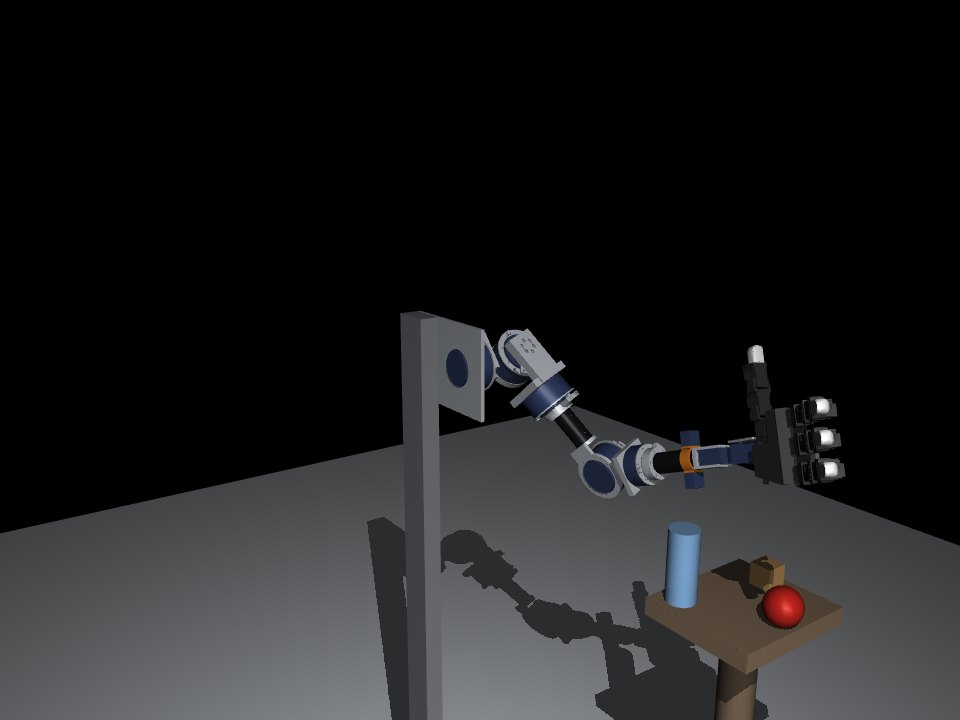
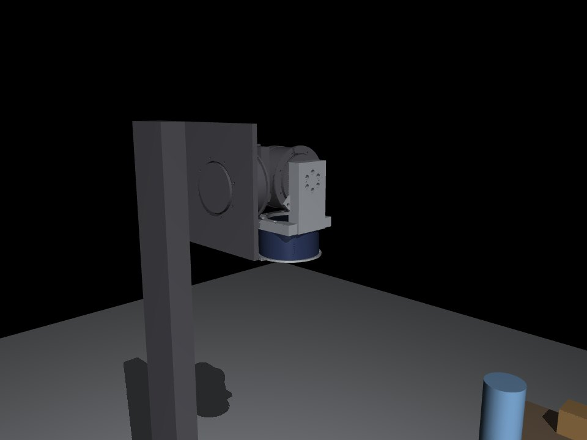

웹캠 앞에서 팔을 움직이면 화면 속 로봇팔이 거울처럼 따라 하는 프로젝트를 만들었다. 처음에는 MuJoCo 안의 개념 모델(직접 만든 5관절 팔과 Shadow Hand)을 움직이는 데서 끝났다. 이번에는 그 로봇팔을 **실제로 사서, 깎고, 조립할 수 있게** 다시 설계했다. 부품을 고르고 CAD를 그리고, 실물 모터와 같은 바이트를 주고받는 제어 코드와 안전 장치를 짜서 시뮬레이션에서 검증했다. 구매 목록과 조립 순서 같은 제작 문서도 만들었다.

하드웨어는 아직 사지 않았다. 아래 내용은 모두 시뮬레이션과 계산으로 확인한 것이다. 실물이 와야 확인할 수 있는 항목은 따로 체크리스트로 남겼다.

| 항목 | 값 |
|---|---|
| 입력 | 노트북 웹캠 하나, MediaPipe Pose + Hand(CPU) |
| 팔 | CubeMars AK80-64 4개(어깨 3축, 팔꿈치), AK60-6 1개(전완 회전) |
| 손목과 손 | Dynamixel XM430 2개(손목 2축), LEAP Hand(XC330 16개) |
| CAD | build123d, 부품 50개, 볼트 114개, STEP/STL과 시뮬레이션 모델을 같은 CAD에서 |
| 질량 | 팔 6.12 kg + LEAP 0.595 kg = 6.72 kg |
| 제어 | 별도 프로세스, 200 Hz, CAN 1 Mbit/s + Dynamixel 4 Mbit/s 두 버스 |
| 안전 | 하드웨어 워치독(Raspberry Pi Pico 계획), 정지 등급 1, 울타리 운전 |
| 검증 | 가상 CAN/시리얼 버스 위 에뮬레이터, 고장 주입, 단계별 냉정한 평가 |



## 1. 전체 흐름

```
웹캠 ─▶ MediaPipe(자세, 손) ─▶ 관절각(어깨 3, 팔꿈치, 전완, 손목 2, 손가락) ─▶ 목표
                                                                     │
               ┌──────────────── 공유 메모리 ───────────────────────┘
               ▼
        드라이버 프로세스(200 Hz) ─▶ CAN: AK 모터 5개, 워치독 ─▶ 팔
                                 └▶ U2D2 두 개: 손목 XM430 2개, LEAP XC330 16개
```

앱은 인식과 렌더만 맡고, 제어 루프는 별도 프로세스로 돈다. 둘은 목표와 상태만 공유 메모리로 주고받는다. 그래서 인식이 잠깐 느려져도 제어 주기가 밀리지 않는다. `--backend sim`이면 같은 드라이버가 가상 버스와 MuJoCo로 돌고, `--backend real`이면 실제 CAN 어댑터와 U2D2 포트를 연다.

## 2. 실제로 만들 수 있는 팔

개념 모델은 관절만 있으면 됐다. 실물은 모터가 어디에 볼트로 붙고, 그 볼트에 렌치가 닿는지까지 맞아야 한다.

- **CAD에서 모든 것을 만든다.** build123d로 브래킷, 모터 어댑터, 정지 링, 카본 관 인서트, 받침대를 그렸다. 가공 부품의 질량과 관성은 CAD 체적에 소재 밀도를 곱해 구하고, 그 값이 그대로 시뮬레이션 모델(MJCF)이 된다. 사서 쓰는 부품은 데이터시트 질량을 쓴다.
- **간섭과 강도.** 무작위 자세와 관절 범위 끝에서 부품끼리 닿는지 검사한다. 최대 토크에서 볼트 전단, 접착부, 판 굽힘의 안전계수를 손계산으로 확인한다.
- **조립 순서와 렌치.** 볼트마다 육각 렌치가 직선으로 닿는지를, 조립 순서대로 그 시점에 놓인 부품을 장애물로 두고 검사한다. 이 검사 덕분에 "브래킷에 다음 모터를 먼저 달고 나서 앞 모터 출력에 단다" 같은 순서가 정해졌다. 문서 순서를 거꾸로 적으면 M3 볼트 6개 중 5개에 렌치가 닿지 않는다는 것을 평가 단계에서 잡았다.
- **영점 지그.** 관절마다 정지 링과 브래킷 탭을 함께 지나는 Ø6 지그 핀 구멍을 둔다. 핀을 꽂은 채 전원을 넣어 영점을 잡는다.


_CAD에서 만든 시뮬레이션 모델을 렌더한 그림. 실물 사진이 아니다._

## 3. 실물과 같은 바이트를 가상 버스에서

모터가 없으니, 모터처럼 행동하는 것을 만들었다.

- **프로토콜 코덱**: AK80-64(구형 MIT 모드)와 AK60-6(V3)의 CAN 프레임, Dynamixel Protocol 2.0 패킷을 매뉴얼 그대로 인코딩한다. 독립 기준과 바이트가 일치하는지 시험한다.
- **에뮬레이터**: 펌웨어의 PD 제어, 토크-속도 선, 전원 투입 때의 각도 모호함, 에러 코드, Dynamixel EEPROM과 RAM, Return Delay Time을 흉내 낸다. CAN은 실제처럼 공유 매체라 우선순위 중재와 프레임 길이만큼의 시간이 걸린다.
- **매뉴얼에 없는 동작은 설정값**으로 둔다. 예를 들어 모터 에러 때 토크를 끊는지, 계속 도는지 같은 것이다. 드라이버는 모든 값에서 통과해야 한다.
- **고장 주입**: 프레임 손실과 지연, 바이트 손상, 버스 끊김, 어댑터 송신 실패, PC 멈춤, 모터 에러, 엔코더 튐을 넣어도 정해진 대로 멈추는지 본다.

같은 드라이버 코드가 python-can과 pyserial로 실물 어댑터를 열 때도 그대로 쓰인다.

## 4. 컴퓨터가 멈추면

AK80-64에는 브레이크가 없다. 전원을 바로 끊으면 팔이 떨어진다. 그래서 정지는 **정지 등급 1**이다. 위치를 잠깐 잡고, 받침대 위 쉬는 자세까지 천천히 내린 뒤에 전원을 끊는다.

문제는 PC 자체가 멈출 때다. 그래서 CAN 버스에 작은 보드(워치독)를 하나 더 둔다.

- PC는 50 Hz로 하트비트를 보낸다. 100 ms 동안 오지 않으면 워치독이 넘겨받는다.
- 워치독은 모터 응답을 엿들어 현재 위치를 알고, 시작 때 PC가 넘겨준 영점 오프셋으로 쉬는 자세를 안다. 그 자세까지 천천히 내린 뒤 전원 허가를 내린다.
- 워치독 논리는 MicroPython과 시뮬레이션이 같은 파일을 쓴다. 시뮬레이션에서 팔을 든 채 PC를 멈추면, 팔이 몇 도 처졌다가 받침대로 내려앉는다(소개 영상의 장면도 이 기록이다).

## 5. 왜 울타리 운전인가

처음 목표는 사람이 옆에 있어도 되는 협동 운전이었다. 관절 토크 상한으로 사람에게 가는 힘을 제한하려 했지만, 팔꿈치가 거의 펴진 자세에서는 관절 토크가 작아도 팔 끝의 힘이 커진다. 이 시스템에는 안전 등급 부품(토크 센서, 안전 PLC)도 없다. 그래서 **사람은 울타리 밖에 두는 방식**으로 정했다.

- 전원은 접촉기 두 개(K1, K2)를 직렬로 거친다. K1은 안전 릴레이가, K2는 워치독 허가가 붙잡는다. 둘 중 하나만 열려도 전원이 끊긴다.
- 문 잠금은 접촉기가 **실제로 열린 것이 확인될 때만** 풀린다. 문이 열려 있는 동안은 안전 등급 경로가 전원을 막고, 다시 켜는 것은 울타리 밖 리셋 버튼뿐이다.
- 비상정지를 누르면 팔은 정지 등급 1로 내려앉고(최대 약 8.5 s), 지연 안전 릴레이(9 s)가 무슨 일이 있어도 전원을 끊는다.
- 접촉력 제한은 사람 보호가 아니라 물체와 구조 보호다. 테이블과 바닥은 드라이버 모델에 들어 있어 닿기 전에 멈춘다.

## 6. 앱에 붙이기

- **팔**: 개념 모델의 IK를 그대로 쓰고 관절 범위만 실물 값으로 바꿨다. 같은 7개 관절값에서 두 모델의 손바닥 방향이 일정하게 맞는 것을 시험으로 확인했다.
- **손**: 사람 손가락 각도를 LEAP Hand 16관절로 옮긴다. 하다 보니 **LEAP 왼손은 오른손의 거울상이 아니었다.** 실물처럼 같은 부품으로 조립하기 때문이다. 그래서 로봇 손 쪽의 모델로 손가락 부호와 엄지를 따로 맞춘다.
- **테이블 가까이 쥐기**: 드라이버가 0.15 s 앞을 보고 충돌을 막는데, 이 예측이 목표 너머까지 이어져서 테이블 바로 위 목표에서 팔이 몇 도 앞에 멈춘 채 풀리지 않았다. 앞을 보는 거리를 "목표까지 + 팔의 과도 응답 2도"로 줄여 고쳤다.
- **인식 처리량**: 실물 경로를 붙이자 녹화 영상 처리량이 처음에는 27 % 떨어졌다. 원인을 하나씩 나눠 보니 셋이었다. LEAP 엄지 맞춤의 반복 횟수, 측정 시간에 종료 정리가 섞이던 버그, 시뮬레이션 프로세스와의 CPU 경쟁이다. 다 고친 뒤 5쌍 교대 측정에서 중앙값 -9.8 %로 기준(10 %) 안에 들었다.

## 7. 제작 문서

코드 저장소에 `docs/build/`로 넣었다.

| 문서 | 내용 |
|---|---|
| 구매 목록 | 모터, 서보, 손, 전원, 안전 회로 부품, 볼트와 핀. 볼트와 핀 개수는 CAD가 센 값에 여분을 더해 자동 생성 |
| 가공 목록 | 부품마다 소재, 가공법, 외형, 왼팔 STEP 파일, 구멍 작업(탭, H7 리밍, 접시 자리, 스피곳) |
| 조립 순서 | CAD가 렌치 접근을 검사한 순서 그대로, 단계마다 렌더 그림 |
| 배선도 | 전원 경로, K1/K2와 문 잠금, CAN과 Dynamixel 버스 |
| 시작 절차 | 모터 없이 안전 회로 시험, 영점 지그 시작, 첫 동작 |
| 체크리스트 | 실물이 오면 재서 코드 값을 고정할 항목(펌웨어 동작, 감속기 강성, 마찰, LEAP 관절 순서 등) |


_조립 순서 문서의 그림. 새로 다는 부품은 원래 색, 이미 단 부품은 짙은 회색이다._

구매 목록이 CAD와 맞는지, 조립 순서가 CAD의 조립 순서와 같은지, 울타리 규칙의 팔 도달 거리가 모델에서 잰 값(0.893 m) 이상인지는 시험이 확인한다.

## 8. 진행 방식

단계를 여섯 개로 나눴다(프로토콜, CAD, 에뮬레이터, 드라이버와 안전, 앱 통합, 제작 문서). 단계마다 만든 쪽과 다른 세션의 평가자가 **위험 / 보통 / 통과**로 판정하고, 통과해야 다음으로 넘어갔다. 평가에서 잡힌 것이 많았다. 예를 들면 다음과 같다.

- 워치독 출력으로 끊긴 접촉기를 다시 닫을 방법이 없었다.
- 문 스위치가 9 s 지연 채널에 물려 있었다.
- 앱을 Ctrl+C로 끝내면 드라이버도 같이 죽어 정지 등급 1이 빠졌다.
- 조립 문서 순서대로는 렌치가 닿지 않았다.
- 울타리 위치를 정하는 팔 도달 거리가 16 cm 작게 적혀 있었다.

## 9. 아직 하지 않은 것

- 하드웨어 구매와 조립, 실물에서의 측정. 체크리스트에 정리했다.
- 워치독의 Pico 연결 코드(MCP2515 드라이버, 허가 펄스 출력, 하드웨어 워치독)와 핀 배정.
- 실물 계단 응답과 마찰을 재는 스크립트.
- 케이블 클립 자리(CAD에 아직 없다).
